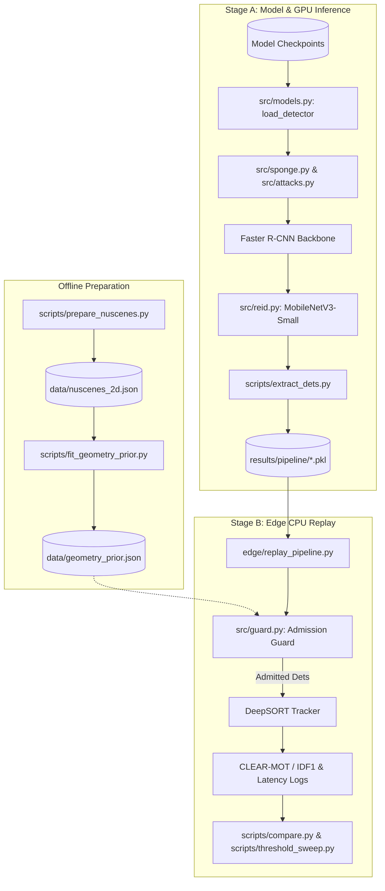

# SARE: Sponge Attacks on Resource-aware Edge Perception


**SARE** evaluates and mitigates resource exhaustion (sponge) attacks targeting adversarial-robust edge perception systems. While adversarial training improves classification and detection robustness, it frequently increases susceptibility to latency, computation, and network saturation attacks. SARE investigates how gradient-based detection inflation (`inflate`, `inflate_hi`, `uap`) overloads two-stage detectors (Faster R-CNN MobileNetV3) and downstream multi-object tracking pipelines (DeepSORT), and introduces lightweight, state-aware admission guards that bound execution overhead on edge hardware like the Raspberry Pi 5 without sacrificing clean tracking performance.

---

## ✨ Features

- **Adversarial Hardening Regimes**: Train detectors against accuracy attacks using standard loss-maximization PGD ($\ell_\infty$, $\ell_2$, $\ell_1$), Multi-Norm Adversarial Training (`mnat`), or Background-Attentive Adversarial Training (`bgat`).
- **Resource Exhaustion (Sponge) Attack Suite**:
  - `inflate`: Two-stage detection inflation targeting non-overlapping survivor counts past NMS.
  - `inflate_hi`: Adaptive attack pushing phantoms above higher confidence cutoffs.
  - `sponge_act`: Classic activation-density sponge maximizing internal backbone layer activations.
  - `uap`: Universal Adversarial Perturbations optimized across frames to generate persistent phantom tracks.
- **Dynamic Perception Guards**:
  - `FixedCap`: Static upper bound on detections per frame.
  - `SAREGuard`: Track-aware admission control using Kalman box predictions and strict entrance thresholds.
  - `AnomalyThreshold` (`thr<K>_t<tau>`): Top-$K$ selection coupled with conditional score thresholds.
  - `GeometryPrior`: Camera geometry priors discarding perspective-violating bounding boxes.
- **Two-Stage Reproducible Pipeline**: Decouple expensive GPU feature extraction from real-time CPU/edge replay on the target device.

---

## 🏗️ Architecture



---

## 💻 Tech Stack

- **Core Framework**: PyTorch, Torchvision
- **Data & Computation**: NumPy, SciPy, Pandas, PyArrow, PyYAML
- **Tracking & Benchmarking**: `deep-sort-realtime`, `motmetrics`
- **Visualization**: Matplotlib
- **Target Platforms**: CUDA-enabled GPUs (Training/Extraction), ARM64 / Raspberry Pi 5 (Edge Replay)

---

## 📁 Project Structure

```text
├── configs/
│   ├── full_matrix.yaml               # Complete evaluation matrix
│   ├── pi5.yaml                       # Edge deployment settings for Raspberry Pi 5
│   ├── train_baseline.yaml            # MOT17 baseline training configuration
│   ├── train_linf_at.yaml             # MOT17 L-inf adversarial training configuration
│   ├── train_mnat.yaml                # MOT17 multi-norm adversarial training configuration
│   └── nuscenes/
│       ├── train_baseline.yaml        # nuScenes baseline configuration
│       ├── train_baseline_aug.yaml    # nuScenes baseline with weather augmentations
│       ├── train_bgat.yaml            # nuScenes background-masked adversarial training
│       ├── train_linf_at.yaml         # nuScenes L-inf adversarial training
│       ├── train_linf_at_aug.yaml     # nuScenes L-inf AT with weather augmentations
│       └── train_mnat.yaml            # nuScenes multi-norm adversarial training
├── edge/
│   ├── power_log.py                   # Power profiling script for edge boards
│   ├── replay_pipeline.py             # Pipeline replay runner for edge hardware
│   └── run_replay.sh                  # Automation script for edge replay passes
├── figures/
│   └── make_figures.py                # Publication figure generation
├── scripts/
│   ├── analyze_pilot.py               # Statistical paired comparison of pilot metrics
│   ├── bench_reid.py                  # Benchmarks ReID embedding ms/crop per device
│   ├── calibrate_budgets.py           # Aligns L1/L2 perturbation budgets to L-inf
│   ├── compare.py                     # Aggregates replay outputs into unified CSV tables
│   ├── extract_dets.py                # Stage A: Extracts detections and embeddings (GPU)
│   ├── fit_geometry_prior.py          # Derives perspective geometry prior from training set
│   ├── prepare_nuscenes.py            # Converts nuScenes CAM_FRONT keyframes to 2D format
│   ├── preview_aug.py                 # Visualizes day-to-night and rain augmentations
│   ├── threshold_sweep.py             # Generates MOTA/IDF1 curves across guard thresholds
│   └── train_uap.py                   # Trains universal adversarial sponge perturbations
├── src/
│   ├── attacks.py                     # Standard PGD loss maximization (L-inf, L2, L1)
│   ├── augment.py                     # Photometric night and rain augmentations
│   ├── data.py                        # Dataset loaders (nuScenes 2D, MOT17)
│   ├── guard.py                       # Admission controllers (SAREGuard, FixedCap, etc.)
│   ├── logutil.py                     # Logging utilities teeing stdout/stderr
│   ├── metrics.py                     # Detection metrics (AP50, Precision, Recall)
│   ├── models.py                      # Faster R-CNN constructors, checkpoint loading
│   ├── reid.py                        # MobileNetV3-Small feature embedder (576-d)
│   ├── sponge.py                      # Inflation and activation sponge objectives
│   └── tracking.py                    # Tracking integration utilities
└── requirements.txt
```

---

## 🚀 Getting Started

### Installation

1. Clone the repository:
   ```bash
   git clone https://github.com/shreeg25/SARE---Sponge-Attack-for-Resource-aware-Edge-AI.git
   cd SARE---Sponge-Attack-for-Resource-aware-Edge-AI
   ```

2. Set up a virtual environment and install dependencies:
   ```bash
   python3 -m venv venv
   source venv/bin/activate
   pip install --upgrade pip
   pip install -r requirements.txt
   ```

### Data Preparation

1. Download the nuScenes dataset (e.g., `v1.0-mini` for local verification or `v1.0-trainval` for full benchmarks) and extract it to `data/nuscenes`.
2. Generate the 2D projected dataset index:
   ```bash
   python scripts/prepare_nuscenes.py --root data/nuscenes --version v1.0-mini --out data/nuscenes_2d.json
   ```
3. Fit the geometric perspective prior on clean training ground truth:
   ```bash
   python scripts/fit_geometry_prior.py
   ```

---

## ⚙️ Running Attacks and Replay

SARE operates in two stages: detection extraction on GPU and pipeline evaluation on CPU/edge.

### 1. Calibrate Budgets and Generate UAP (Optional)

Match $\ell_2$ and $\ell_1$ perturbation budgets to drop accuracy equally:
```bash
python scripts/calibrate_budgets.py --ckpt checkpoints/nuscenes_baseline_s0.pth
```

Optimize a Universal Adversarial Perturbation (UAP) sponge:
```bash
python scripts/train_uap.py \
  --config configs/nuscenes/train_baseline.yaml \
  --ckpt checkpoints/nuscenes_linf_at_aug_s0.pth \
  --iters 2000
```

### 2. Stage A: Run Attacks & Extract Detections (GPU)

Generate and serialize detections across test conditions (`day`, `night`, `rain`, `night_rain`) under clean and attacked conditions:
```bash
python scripts/extract_dets.py \
  --config configs/nuscenes/train_linf_at_aug.yaml \
  --ckpt checkpoints/nuscenes_linf_at_aug_s0.pth \
  --attacks clean linf l2 l1 inflate inflate_hi uap \
  --scenes-per-cond 5
```
Outputs are saved to `results/pipeline/<ckpt_stem>/<attack>.pkl`.

### 3. Stage B: Edge Hardware Replay (CPU)

Benchmark embedding latency on the host or Raspberry Pi:
```bash
python scripts/bench_reid.py
```

Replay detections through DeepSORT with various admission control guards:
```bash
python scripts/replay_pipeline.py \
  --run results/pipeline/nuscenes_linf_at_aug_s0 \
  --attacks clean inflate inflate_hi \
  --guards none cap10 thr10_t60 sare10_t60 \
  --reid-ms 1.11 \
  --prior data/geometry_prior.json
```

---

## 📊 Evaluation & Analysis

Aggregate results into summary tables and analyze tracking metrics:

```bash
# Print comparative table and compile results/compare/pipeline_comparison.csv
python scripts/compare.py --condition all

# Run threshold sensitivity sweeps across models and attacks
python scripts/threshold_sweep.py --condition all
```

To compare pilot run activation shifts between baseline and hardened models:
```bash
python scripts/analyze_pilot.py \
  --csv pilot_v2_out/results.csv \
  --ref baseline_s0 \
  --cmp mnat_s0
```

---

## 🤝 Contributing

Contributions to attack objectives, tracker integrations, and edge hardware profiling scripts are welcome. Please format all code with standard PEP 8 practices and ensure new guards adhere to the admission interface defined in `src/guard.py`.
